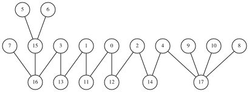

# 大模型的小练习（一）：Written on the Wall II 猜想 #138 的反例

**LLM Exercises I — counterexamples to *Written on the Wall II* conjecture #138**

**Author:** [@yutitan](https://github.com/yutitan) · **Date:** 2026-11-25  
**Derived with:** GPT 6.2 Astra (OpenAI Codex, model `gpt-6.2-astra`) — see [Provenance](#provenance)

[](https://doi.org/10.5281/zenodo.24540807) · **Archived release:** v1.2.0 (2026-11-26)

> **Series note.** 大模型的小练习（一）· LLM Exercises I. Entry (二):
> [Exact escape time of Langton's ant on three-row boards](https://github.com/yutitan/langton-ant-three-rows)
> — archived at [DOI 10.5281/zenodo.24540968](https://doi.org/10.5281/zenodo.24540968).
>
> Entry (三):
> [Langton's ant on n×n boards — an explicit escape-time bound](https://github.com/yutitan/langton-ant-square-bound).

[*Written on the Wall II*](https://www.uhd.edu/academics/sciences/mathematics-statistics/wowii/)
is the catalogue of conjectures produced by the program **Graffiti.pc**
(Ermelinda DeLaViña). It lists conjecture **#138**, announced on July 12, 2005,
as **open**:

> **Conjecture 138.** *If* `G` *is a simple connected graph, then*
>
> `path(G) ≥ (2 + u(G)) · dist_min(M(G²))`.

This repository shows that the conjecture is **false**. It contains explicit
counterexamples, a self-contained verification script, an exhaustive search
showing that the smallest counterexamples among trees have 18 vertices, and a
Lean 4 formalization of one of the 18-vertex witnesses.

As of 2026-11-25 the WOWII web page still lists #138 as open.

## Provenance

This repository is published as a **public record of a personal AI-assisted
exploration**. It makes no priority claim: current models are strong enough
that similar counterexamples may well have been found independently, and no
systematic literature search was attempted (the only check made was that
*Written on the Wall II* still listed conjecture #138 as open on 2026-11-25).

The first witness in this record, the 21-vertex tree `T21`, was derived at
**2026-11-25 13:12:32 UTC** by **GPT 6.2 Astra** (OpenAI Codex, model
`gpt-6.2-astra`), in a session directed by
[@yutitan](https://github.com/yutitan). The three 18-vertex counterexamples and
the minimality claim come from an exhaustive search over all unlabeled trees
with 3–18 vertices, run under the same direction with a second AI coding agent
(DeepSeek Harness). The repository was first published the same day;
[`PROVENANCE.md`](PROVENANCE.md) records the timeline, the Codex session id, the
verifier written at the time, and the relevant hashes.

Every number quoted in this repository is recomputed from the edge lists by
[`verify.py`](verify.py), so nothing here depends on trusting a language model.

## Highlights

* The smallest counterexamples are trees on **18 vertices**.
* Up to isomorphism there are **exactly three** such trees, and there is none
  with fewer vertices.
* For each of them, `path(G) = 14` while the right-hand side is 15: the
  inequality fails by 1.
* The violation is robust with respect to the reading of
  `dist_min(M(G²))`: it holds whether distances are measured in `G²` or in `G`.
* All computations are checked by [`verify.py`](verify.py), which uses only the
  Python standard library.
* One witness (`T18`, isomorphic to `A18`) is formalized in Lean 4
  ([`lean/`](lean/)); the other witnesses and the minimality claim are checked
  by Python only.

## The counterexamples

<p align="center">
  
</p>

The tree **A18** (18 vertices; edge list and graph6 in [`data/`](data/)):

```
edges:  0-11  0-12  1-11  1-13  2-12  2-14  3-13  3-16  4-14  4-17
        5-15  6-15  7-16  8-17  9-17  10-17  15-16
graph6: Q?????????W?g?S?D??K?COCGw?
```

| quantity | value |
| --- | --- |
| `path(A18)` | **14** — a longest induced path is `5-15-16-3-13-1-11-0-12-2-14-4-17-8` |
| `u(A18)` | **1** — the maximum independent set `{0,1,2,3,4,5,6,7,8,9,10}` is unique |
| maximum degree of `A18²` | 6 |
| `M(A18²)` | **{4, 16}** — the only vertices of degree 6 in the square |
| `dist_min(M(A18²))` | **5** — distance in `A18²`; the distance in `A18` is 9 |
| `(2 + u(A18)) · dist_min` | **15** |

Hence

`path(A18) = 14 < 15 = (2 + u(A18)) · dist_min(M(A18²))`,

so conjecture #138 fails for `A18`.

All witnesses in this repository:

| tree | n | path | u | M(G²) | dist_min in G² | dist_min in G | RHS (G²) | RHS (G) | violated? |
| --- | --- | --- | --- | --- | --- | --- | --- | --- | --- |
| [`A18`](data/tree-A18.edges) | 18 | 14 | 1 | {4,16} | 5 | 9 | 15 | 27 | **yes** |
| [`B18`](data/tree-B18.edges) | 18 | 14 | 1 | {6,17} | 5 | 9 | 15 | 27 | **yes** |
| [`C18`](data/tree-C18.edges) | 18 | 14 | 1 | {16,17} | 5 | 9 | 15 | 27 | **yes** |
| [`T21`](data/tree-21.edges) | 21 | 17 | 1 | {0,12} | 6 | 12 | 18 | 36 | **yes** |

`T21` is the 21-vertex tree that was found first in this exploration (see
[Provenance](#provenance)); the three 18-vertex trees were found by the
exhaustive search described below. `A18` is isomorphic to the
18-vertex tree given in
[`data/tree-18-original-labels.edges`](data/tree-18-original-labels.edges).

## Verification

```bash
python3 verify.py
```

The script builds every witness from its edge list, checks that it is a tree,
computes `path(G)` by exhaustive search over induced paths, computes `u(G)` by
exhaustive enumeration of independent sets (all `2^n` subsets), and derives
`M(G²)` and `dist_min` from scratch. It also checks the graph6 strings against
the edge lists, asserts the exact values in the table above, and exits with
status 0 only if all checks pass. Python 3.10 or newer is sufficient; there are
no third-party dependencies.

The recorded output is in [`verify.out`](verify.out).

### Lean 4 formal verification (one witness only)

[`lean/Wowii138.lean`](lean/Wowii138.lean) formalizes the 18-vertex witness
`T18` (the tree of
[`data/tree-18-original-labels.edges`](data/tree-18-original-labels.edges),
isomorphic to `A18`) and proves
`connected_counterexample : T18.Connected ∧ ¬ Conjecture138 T18`: it shows
that `T18` is a tree, that `u(T18) = 1` with a unique maximum independent set
of size 11, that `M(T18²) = {1, 13}` and `dist_min(M(T18²)) = 5`, and that
every induced path of `T18` has at most 14 vertices (a 14-vertex induced path
exists). The file contains no `sorry` and no `native_decide`; its
`#print axioms` report only `propext`, `Classical.choice` and
`Quot.sound`. It was checked with Lean 4.37.0-rc1 and Mathlib
`c44d09c9afd6296ba2d4c0c3712b3592ac899078`.

**Scope.** The Lean development covers **one** witness. The claims that there
are exactly three 18-vertex counterexamples and that no smaller tree is a
counterexample are *not* formalized; they rest on the Python exhaustive search
below. See [`lean/README.md`](lean/README.md) for the toolchain, the
reproduction command and the full list of what is and is not formalized.

## Exhaustive search among trees

[`search/search_trees.py`](search/search_trees.py) uses
[nauty](https://pallini.di.uniroma1.it/)'s `geng` to generate **all** unlabeled
trees and checks each one:

```bash
sudo apt install nauty        # Debian/Ubuntu
python3 search/search_trees.py --max-n 18
```

Recorded output: [`search/results.txt`](search/results.txt).

| n | trees | counterexamples |
| --- | --- | --- |
| 3–17 | 81,135 | 0 |
| 18 | 123,867 | 3 (`A18`, `B18`, `C18`) |
| 3–18 | 205,002 | 3 |

The tree counts agree with OEIS [A000055](https://oeis.org/A000055). The script
cross-checks its tree DP against brute force (`--verify`) and was used to
produce these numbers.

**Scope.** This exhaustive search covers trees. We did not exhaust all connected
graphs, so a smaller counterexample involving cycles is not excluded; to our
knowledge the three trees above are the smallest known counterexamples.

## Two ambiguities in the published statement

### (a) Definition 74 omits the word "maximum"

WOWII definition 74 reads (retrieved 2026-11-25):

> **Unique maximum independent set characteristic function denoted u(G)** is 1
> if *G* is has a unique independent set and 0 otherwise.

The bold title says *maximum*, while the sentence omits it (and contains the typo
"is has"). Read literally, `u(G) = 0` for every graph with at least one vertex:
the empty set and every singleton are independent sets. With `u ≡ 0` the
conjecture becomes `path(G) ≥ 2 · dist_min(M(G²))`, which is true for every
connected graph (a shortest path between two vertices of `M(G²)` is induced and
has at least `2 · dist_min(M(G²))` vertices). So the literal text is degenerate,
and the intended definition is the one in the title. WOWII's own comment on
conjecture #139 confirms this: it records `u(G) = 1` for a graph and treats the
graph as a counterexample, which is only consistent with "unique maximum
independent set".

All computations in this repository use the intended reading. Under the literal
reading none of these trees is a counterexample — which is exactly why the
definition should be corrected.

### (b) In which graph is `dist_min(M(G²))` measured?

Definition 19 defines `dist_min(M)` using distances in "the graph". For
`M(G²)` one can take the ambient graph to be `G²` (the reading used here) or
`G`. The table reports both; in either reading the right-hand side exceeds
`path(G)`, so the counterexamples do not depend on this choice.

## Files

| path | contents |
| --- | --- |
| [`verify.py`](verify.py) | self-contained verification of the four witnesses (standard library only) |
| [`lean/Wowii138.lean`](lean/Wowii138.lean) | Lean 4 formalization of the `T18` witness (one witness only; no exhaustive minimality) |
| [`search/search_trees.py`](search/search_trees.py) | exhaustive search among trees (requires nauty) |
| [`data/`](data/) | edge lists and graph6 strings of the witnesses |
| [`figures/`](figures/) | drawings of the witnesses (SVG and PNG), with `.dot` sources |
| [`note/note.md`](note/note.md) | more detailed write-up, including human-checkable certificates |
| [`CITATION.cff`](CITATION.cff) | machine-readable citation metadata |

## Reproducing everything

```bash
git clone https://github.com/yutitan/wowii-conjecture-138
cd wowii-conjecture-138
python3 verify.py                          # seconds, no dependencies
sudo apt install nauty                     # for the exhaustive search
python3 search/search_trees.py --max-n 18  # about a minute
# optional: Lean 4 check of one witness — see lean/README.md (needs Mathlib)
```

## Citation

If you use this material, please cite it (see [`CITATION.cff`](CITATION.cff)):

Archived releases are on Zenodo: **v1.2.0** has DOI [10.5281/zenodo.24540807](https://doi.org/10.5281/zenodo.24540807) (concept DOI [10.5281/zenodo.24538088](https://doi.org/10.5281/zenodo.24538088); v1.1.0 has DOI [10.5281/zenodo.24538089](https://doi.org/10.5281/zenodo.24538089)). The DOI always refers to the archived snapshot; later commits are not part of it.

```bibtex
@misc{yutitan2026wowii138,
  author       = {yutitan},
  title        = {大模型的小练习（一）：Counterexamples to {Written on the Wall II} conjecture \#138},
  year         = {2026},
  howpublished = {\url{https://github.com/yutitan/wowii-conjecture-138}},
  publisher    = {Zenodo},
  doi          = {10.5281/zenodo.24540807},
  note         = {Graffiti.pc conjecture 138, announced 2005-07-12}
}
```

## License

* Code (`verify.py`, `search/search_trees.py`): MIT — see [`LICENSE`](LICENSE).
* Text, data and figures: [CC BY 4.0](https://creativecommons.org/licenses/by/4.0/) —
  see [`LICENSE-CONTENT.md`](LICENSE-CONTENT.md).

## Links

* Written on the Wall II: <https://www.uhd.edu/academics/sciences/mathematics-statistics/wowii/>
* nauty and Traces: <https://pallini.di.uniroma1.it/>
* OEIS A000055 (number of unlabeled trees): <https://oeis.org/A000055>
