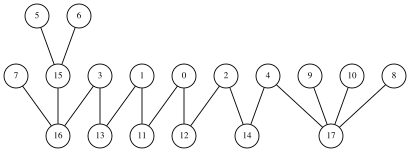

# Counterexamples to *Written on the Wall II* conjecture #138

**yutitan** · 2026-11-25

## Abstract

Conjecture #138 of *Written on the Wall II*, a catalogue of conjectures of the
program Graffiti.pc, asserts that every simple connected graph `G` satisfies

`path(G) ≥ (2 + u(G)) · dist_min(M(G²))`.

We exhibit trees that violate this inequality. The smallest counterexamples are
three trees on 18 vertices; no tree with fewer vertices violates the conjecture.
A 21-vertex witness is included as well. The claims are checked by a
self-contained Python script (`verify.py`, standard library only), and an
exhaustive enumeration of all 205,002 unlabeled trees with 3 to 18 vertices
using nauty's `geng`. We also discuss two defects of the published statement:
definition 74 omits the word "maximum", and `dist_min(M(G²))` can be read with
distances taken in `G²` or in `G`.

## 1. The conjecture

[Written on the Wall II](https://www.uhd.edu/academics/sciences/mathematics-statistics/wowii/)
lists the following as conjecture **#138** (announced July 12, 2005; the entry
was still marked *open* on 2026-11-25):

> **Conjecture 138.** *If G is a simple connected graph, then*
> `path(G) ≥ (2 + u(G)) · dist_min(M(G²))`.

The relevant definitions on the WOWII page are:

* **Definition 35** (path number): `path(G)` is the number of vertices of a
  largest induced path of `G`.
* **Definition 74** (unique maximum independent set characteristic function):
  `u(G)` is 1 if `G` has a unique maximum independent set and 0 otherwise.
  (The published sentence reads "unique independent set"; see Section 4.1.)
* **Definition 19** (distance between maximum degree vertices): for the set
  `M` of vertices of maximum degree, `dist_min(M)` is the minimum of
  `dist(u,v)` over distinct `u,v ∈ M`.
* **Definition 75** (second power): `G²` has the same vertex set as `G`, with
  two vertices adjacent if and only if their distance in `G` is at most 2.

## 2. The witnesses

### 2.1 The tree A18

<p align="center">
  
</p>

```
vertices: 0, 1, ..., 17
edges:    0-11, 0-12, 1-11, 1-13, 2-12, 2-14, 3-13, 3-16, 4-14, 4-17,
          5-15, 6-15, 7-16, 8-17, 9-17, 10-17, 15-16
graph6:   Q?????????W?g?S?D??K?COCGw?
```

`A18` is the tree in [`data/tree-A18.edges`](../data/tree-A18.edges)
(nauty canonical labelling).

**(i) `A18` is a tree.** It has 18 vertices and 17 edges, and it is connected:
`5` and `6` attach to `15`; `15` continues to `16`, then along the
spine `16-3-13-1-11-0-12-2-14-4-17`; `7` attaches to `16` and
`8, 9, 10` attach to `17`.

**(ii) `path(A18) = 14`.** The path

`5-15-16-3-13-1-11-0-12-2-14-4-17-8`

has 14 vertices. It is a longest path: the leaves of `A18` are
`5, 6, 7, 8, 9, 10`; the only leaf-to-leaf path of maximum length joins one of
`{5,6}` to one of `{8,9,10}` and has `2 + 11 + 1 = 14` vertices (the
spine `15-16-3-13-1-11-0-12-2-14-4-17` has 12 vertices). In a tree every
path is induced, so `path(A18) = 14`.

**(iii) `u(A18) = 1`.** The unique maximum independent set is

`{0, 1, 2, 3, 4, 5, 6, 7, 8, 9, 10}` (11 vertices).

It is independent: every edge of `A18` has at least one endpoint in
`{11, ..., 17}`. It is maximum and unique; Appendix A gives a short tree-DP
certificate that can be checked by hand, and `verify.py` checks uniqueness by
exhaustive enumeration of all `2^18` subsets.

**(iv) `M((A18)²) = {4, 16}` and the two vertices are at distance 5 in the
square.** The degrees in the square `(A18)²` are

```
vertex:  0  1  2  3  4  5  6  7  8  9 10 11 12 13 14 15 16 17
degree:  4  4  4  5  6  3  3  3  4  4  4  4  4  4  4  5  6  5
```

so the maximum degree is 6, attained exactly at `4` and `16`. In `A18`,
`dist(4,16) = 9` (for example `4-14-2-12-0-11-1-13-3-16`). In `G²`,
`dist(4,16) = 5`: the path `4-2-12-11-13-16` has five `G²`-edges, and a
path of length `k` in `G²` can shorten a `G`-path by at most a factor 2, so
no shorter `G²`-path exists. Hence `dist_min(M((A18)²)) = 5`.

**(v) The inequality fails.** Thus

`(2 + u(A18)) · dist_min(M((A18)²)) = 3 · 5 = 15 > 14 = path(A18)`.

### 2.2 The other two 18-vertex counterexamples

The exhaustive search of Section 3 shows that, up to isomorphism, exactly three
trees on 18 vertices violate the conjecture. Besides `A18` there are
`B18` and `C18` ([`data/tree-B18.edges`](../data/tree-B18.edges),
[`data/tree-C18.edges`](../data/tree-C18.edges)). Both have the same
numerical profile:

| tree | path | u | M(G²) | dist_min in G² | dist_min in G | RHS in G² | RHS in G |
| --- | --- | --- | --- | --- | --- | --- | --- |
| `A18` | 14 | 1 | {4,16} | 5 | 9 | 15 | 27 |
| `B18` | 14 | 1 | {6,17} | 5 | 9 | 15 | 27 |
| `C18` | 14 | 1 | {16,17} | 5 | 9 | 15 | 27 |

(`A18` is isomorphic to the 18-vertex tree written down first in this
investigation; that labelling is kept in
[`data/tree-18-original-labels.edges`](../data/tree-18-original-labels.edges).)

### 2.3 The 21-vertex witness T21

The tree `T21` ([`data/tree-21.edges`](../data/tree-21.edges)) was the
first witness found. It consists of a path `0-1-...-12` with two paths of
length 2 attached at each end (`0-13-14`, `0-15-16`, `12-17-18`,
`12-19-20`). Its data are

| quantity | value |
| --- | --- |
| `path(T21)` | 17 |
| `u(T21)` | 1 |
| `M(T21²)` | {0,12} |
| `dist_min` in `G²` | 6 |
| `dist_min` in `G` | 12 |
| RHS in `G²` / in `G` | 18 / 36 |

so `17 = path(T21) < 18`.

## 3. Exhaustive search among trees

[nauty](https://pallini.di.uniroma1.it/)'s `geng` generates all unlabeled
connected graphs with a prescribed number of edges; taking `n` vertices and
`n-1` edges gives exactly the trees. The script
[`search/search_trees.py`](../search/search_trees.py) runs

```
geng -c -q n (n-1):(n-1)
```

for `n = 3, ..., 18`, analyses every tree, and reports all violations. The
recorded output is [`search/results.txt`](../search/results.txt).

| n | number of trees | counterexamples |
| --- | --- | --- |
| 3–17 | 81,135 | 0 |
| 18 | 123,867 | 3 (`A18`, `B18`, `C18`) |
| 3–18 | 205,002 | 3 |

The counts agree with OEIS A000055. Consequently:

* no tree with fewer than 18 vertices violates conjecture #138;
* up to isomorphism there are exactly three counterexamples on 18 vertices.

The search uses a tree DP for `u(G)` and the identity
`path(G) = diameter(G) + 1` for trees; both are cross-checked against
brute force for all trees with at most 10 vertices
(`python3 search/search_trees.py --max-n 10 --verify`).

**Scope.** The exhaustive search covers trees only. We did not enumerate all
connected graphs, so a counterexample with cycles and fewer than 18 vertices is
not excluded. To our knowledge the three trees above are the smallest known
counterexamples.

## 4. Remarks on the published statement

### 4.1 Definition 74 omits "maximum"

The published text of definition 74 is:

> **Unique maximum independent set characteristic function denoted u(G)** is 1
> if *G* is has a unique independent set and 0 otherwise.

Two things are wrong: the body omits *maximum* (present in the title), and it
contains the typo "is has". Read literally, the body defines `u(G) = 0` for
every graph on at least one vertex, since the empty set and every singleton are
independent. With `u ≡ 0` the conjecture becomes
`path(G) ≥ 2 · dist_min(M(G²))`. This is true for every connected graph: if
`d = dist_min(M(G²))`, a shortest `G`-path between the relevant vertices has
length at least `2d-1`, is induced, and therefore has at least `2d` vertices.
So the literal text makes conjecture #138 trivially true and the definition
vacuous.

That the intended meaning is the title's is confirmed by WOWII itself: for the
closely related conjecture #139 (same batch, same date) the WOWII comment says

> The counterexample to 105 was also a counterexample to this conjecture. Path
> number is 4, *u(G)=1*, and *dist_avg(C)=43/28*.

so `u(G)` is used as an indicator of a unique maximum independent set.

All computations in this repository use the intended reading. If the published
body of definition 74 is taken literally, none of the trees here is a
counterexample; the definition should be corrected.

### 4.2 Distance in `G²` or in `G`?

Definition 19 writes distances as `dist_G`, i.e. distances in the graph under
consideration. The set `M(G²)` is computed in `G²`, so one may read
`dist_min(M(G²))` as a distance in `G²` (the reading used here) or in `G`.
The counterexamples do not depend on this choice: with distances in `G` the
right-hand side is 27 for the three 18-vertex trees and 36 for `T21`, still
larger than `path(G)` (14 and 17).

## 5. Reproducibility

```
python3 verify.py                            # no dependencies, seconds
sudo apt install nauty                       # for the search
python3 search/search_trees.py --max-n 18    # about a minute
```

The verification is computational; no proof-assistant formalisation is
provided. The numbers in this note are exactly the ones asserted by
`verify.py` and printed in Appendix B.

## Appendix A: tree-DP certificate for `u(A18) = 1`

Root `A18` at vertex 0. For a vertex `v` let `A0(v)` and `A1(v)` be the
sizes of a maximum independent set of the subtree at `v` with `v` excluded,
respectively included; let `C0(v)` and `C1(v)` be the corresponding numbers
of such sets, capped at 2. Then

```
A1(v) = 1 + sum A0(w)          over children w
C1(v) = prod C0(w)
A0(v) = sum max(A0(w), A1(w))
C0(v) = product of the counts that realise the maximum (sum of counts at ties)
```

The table gives `(A0, C0)` and `(A1, C1)` for every vertex in post-order:

| v | children | (A0, C0) | (A1, C1) |
| --- | --- | --- | --- |
| 6 | – | (0, 1) | (1, 1) |
| 5 | – | (0, 1) | (1, 1) |
| 10 | – | (0, 1) | (1, 1) |
| 9 | – | (0, 1) | (1, 1) |
| 8 | – | (0, 1) | (1, 1) |
| 7 | – | (0, 1) | (1, 1) |
| 15 | 5, 6 | (2, 1) | (1, 1) |
| 17 | 8, 9, 10 | (3, 1) | (1, 1) |
| 16 | 7, 15 | (3, 1) | (3, 1) |
| 4 | 17 | (3, 1) | (4, 1) |
| 3 | 16 | (3, 2) | (4, 1) |
| 14 | 4 | (4, 1) | (4, 1) |
| 13 | 3 | (4, 1) | (4, 2) |
| 2 | 14 | (4, 2) | (5, 1) |
| 1 | 13 | (4, 2) | (5, 1) |
| 12 | 2 | (5, 1) | (5, 2) |
| 11 | 1 | (5, 1) | (5, 2) |
| 0 | 11, 12 | (10, 2) | (11, 1) |

At the root, the maximum size is 11, attained with vertex 0 included and with
count 1; hence `alpha(A18) = 11` and the maximum independent set is unique.
It is `{0,1,2,3,4,5,6,7,8,9,10}`.

## Appendix B: `verify.py` output

The full output is in [`verify.out`](../verify.out), and the output of the
exhaustive search is in [`search/results.txt`](../search/results.txt).
